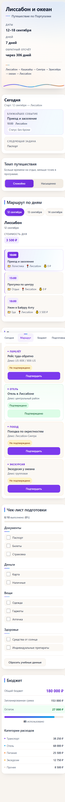
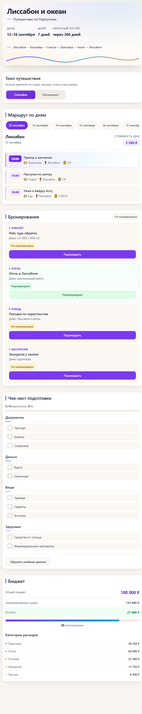

# Маршрут — адаптивный планировщик путешествия

Веб-приложение для подготовки к поездке: маршрут по дням, бюджет,
бронирования и чек-лист — на одном экране. Демо-поездка **«Лиссабон и океан»**:
7 дней, Португалия, бюджет 180 000 ₽.

Написано **на чистом HTML, CSS и JavaScript** — без фреймворков, без npm,
без сборки и без единой внешней зависимости. Открывается двойным кликом по
`index.html` и работает офлайн.

<p>
  
  
  
  
</p>



## Задача

По [дизайн-брифу](docs/design-brief.md) собрать адаптивное приложение
путешественника, которое показывает поездку целиком: где вы в маршруте,
что запланировано на день, сколько потрачено и что уже готово для отъезда.
Требования брифа: три контрольные ширины (1440 / 768 / 390), четыре состояния
интерфейса, сохранение прогресса без бэкенда — и запрет на фреймворки.

Основная сложность — уложить состояние (день + темп + бронирования + чек-лист)
в одну страницу на ванильном JS так, чтобы код остался читаемым на ~1400 строк.

## Возможности

- **Обложка поездки** — название, даты, живой обратный отсчёт и нарисованная
  на SVG линия маршрута Лиссабон → Кашкайш → Синтра → Эрисейра → океан → Лиссабон.
- **Темп путешествия** — переключатель «Спокойно» / «Насыщенно» пересобирает
  программу дня и пересчитывает прогноз бюджета: 153 000 ₽ против 180 000 ₽.
- **Маршрут по дням** — 7 дней с событиями, временем, категорией и стоимостью;
  переключение дня без перезагрузки страницы.
- **Бюджет** — общий лимит, запланировано, остаток, прогресс-бар и пять
  категорий расходов.
- **Бронирования** — перелёт, отель, поезд, экскурсия; статус «Не подтверждено»
  меняется кнопкой «Подтвердить» с всплывающим уведомлением.
- **Чек-лист подготовки** — 10 пунктов в категориях «Документы», «Деньги»,
  «Вещи», «Здоровье»; отметки переживают перезагрузку (`localStorage`).
- **Мобильный режим «Сегодня»** — на узком экране наверх выносится ближайшее
  событие и следующая задача, внизу — навигация «Сегодня / Маршрут / Бюджет /
  Подготовка».
- **Четыре состояния интерфейса** — `loading` (скелетоны), `error`
  (сообщение + «Повторить»), `empty` (день без событий), `success`. Проверяются
  вручную через панель «Демо состояний» в углу экрана.

| Планшет, 768 px | Мобильный режим «Сегодня», 390 px |
|---|---|
|  |  |

## Как это устроено

```
app.js
  ├── Данные:  TRIP, DAYS (7 дней × calm/intense), PACE_CONFIG,
  │            BOOKINGS_INITIAL, CHECKLIST_INITIAL, BUDGET_CATEGORIES
  │
  ├── state:   выбранный день · темп · статусы бронирований · чек-лист
  │
  ├── Рендер:  renderCover / renderPaceToggle / renderRouteDays /
  │            renderRouteSchedule / renderBudget / renderBookings /
  │            renderChecklist / renderTodayMobile  →  renderAll()
  │
  └── Хранение: localStorage «routePlanner.bookings|checklist»
                 ↺ кнопка «Сбросить учебные данные»
```

Клик меняет `state` и вызывает только затронутый рендер: переключение дня
обновляет расписание и бюджет, подтверждение бронирования — только карточку
и счётчик. Даты поездки вычисляются при каждом запуске: берётся
12–18 сентября текущего года, а после этой даты — следующего, поэтому
обратный отсчёт всегда показывает осмысленное значение.

Подробнее о решениях — в [docs/ARCHITECTURE.md](docs/ARCHITECTURE.md),
исходный бриф — в [docs/design-brief.md](docs/design-brief.md).

## Стек

| Слой | Технологии |
|---|---|
| Разметка | HTML5, семантические теги, ARIA |
| Оформление | CSS3: переменные, Grid, Flexbox, `@media` |
| Логика | JavaScript ES6+, без библиотек |
| Хранение | Web Storage API (`localStorage`) |
| Сборка | нет — файлы открываются напрямую |
| Зависимости | 0 |

## Быстрый старт

Клонируйте и откройте страницу:

```bash
git clone https://github.com/IvetaRHG/marshrut-trip-planner.git
cd marshrut-trip-planner
```

Дальше любой вариант:

- открыть `app/index.html` двойным кликом — работает по `file://`;
- или запустить локальный сервер:
  ```bash
  python -m http.server 8000 --directory app
  # → http://localhost:8000
  ```

Установка, сборка, ключи и аккаунты не нужны. Все данные демонстрационные,
прогресс (чек-лист, брони) хранится только в вашем браузере.

## Инженерные решения

- **Ноль зависимостей — осознанный выбор.** Никакого фреймворка и сборки:
  данные, состояние и рендер разделены на уровне структуры файла, точечные
  `render*()`-функции заменяют реактивность. Приложение не устареет вместе
  с экосистемой и работает офлайн.
- **Единый источник правды.** Секция не хранит своё состояние: всё живёт
  в одном объекте `state`, интерфейс — функция от него.
- **Состояния как часть архитектуры.** Каждая секция обёрнута в контейнер
  и проходит через `showSectionState()`: скелетоны, ошибка с «Повторить»,
  пустой день. Секции независимы — одна может быть в `error`, другая
  в `success`.
- **Защита от инъекций.** Динамический HTML собирается из данных через
  `escapeHtml()` / `textContent` — содержимое из `localStorage` не может
  исполниться как разметка.
- **Уважение к настройкам ОС.** `prefers-reduced-motion` отключает плавную
  прокрутку и анимации для пользователей с ограниченной подвижностью.
- **Доступность.** Семантическая разметка, `aria-pressed` на переключателях,
  `aria-live` для уведомлений, полная работа с клавиатуры.
- **Иммунитет к «протуханию» демо.** Даты поездки пересчитываются при каждом
  запуске — обратный отсчёт не ломается со временем.

## Приватность

Приложение не отправляет ни одного сетевого запроса: нет CDN, шрифтов,
картинок и аналитики. Прогресс хранится локально в `localStorage` браузера
и удаляется кнопкой «Сбросить учебные данные».

## Ограничения

- Данные одной демонстрационной поездки зашиты в код — редактировать поездку
  можно в `app.js`, интерфейса настройки нет.
- Хранение в `localStorage` не синхронизируется между устройствами.
- Часовой пояс и локаль — браузерные; даты выводятся в формате «12 сентября».

## Что можно добавить

- Загрузку поезда из JSON-файла через `fetch` — машина состояний уже готова
  к асинхронности.
- Экспорт маршрута в ICS (календарь) и PDF.
- Тёмную тему — вся палитра на CSS-переменных.
- Несколько поездок с выбором на старте.
- E2E-тесты на Playwright: переключение темпа, дней, подтверждение брони.

## Ветки и версии

| Ветка | Назначение |
|---|---|
| `main` | Стабильная версия. Каждый коммит пригоден к использованию. |
| `develop` | Интеграционная ветка: сюда сливаются изменения перед релизом. |

Рабочий процесс:

```
feature/<название>  ──►  develop  ──►  main  ──►  тег vX.Y.Z
```

Версия релиза — в [Releases](https://github.com/IvetaRHG/marshrut-trip-planner/releases).

---

Проект выполнен в рамках обучения в Zerocoder. Все даты, суммы, адреса и
бронирования — демонстрационные данные.
